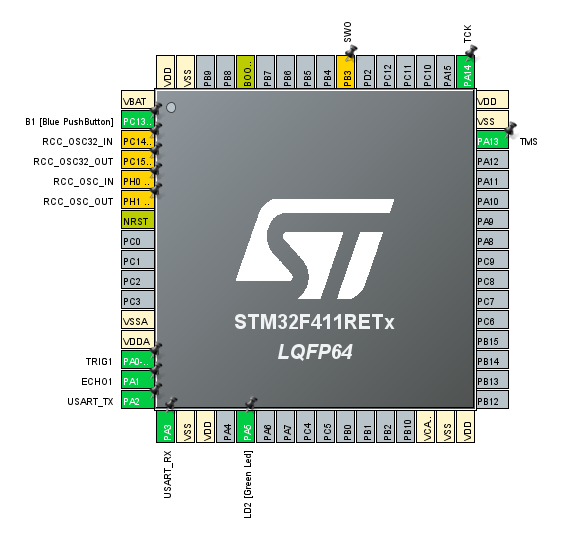
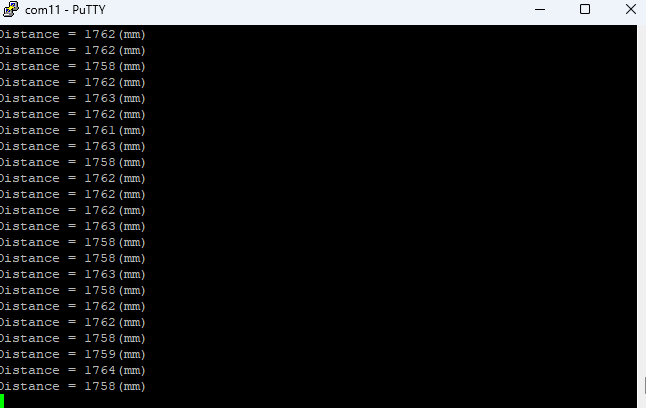

# HC-SR04 (STM32F411)

## HC-SR04 

<details>
<summary>HC-SR04 (클릭해서 펼치기)</summary>

 <br>
 <br>

</details>

## Trig 파형 측정

<details>
<summary>Trig 파형 측정 (클릭해서 펼치기)</summary>

 while 안에서 trig() 다음에 delay_us만 넣은 코드로 센서의 TRIG 핀 파형을 오실로스코프로 확인.

```c
  

  /* Infinite loop */
  /* USER CODE BEGIN WHILE */
  while (1)
  {
	  trig();
	  delay_us(200);

    /* USER CODE END WHILE */

    /* USER CODE BEGIN 3 */
  }
```

 <br>
 <br>

</details>

## TEST

<details>
<summary>TEST (클릭해서 펼치기)</summary>

초음파 센서 HC_SR-04를 이용해 앞 물체와의 거리를 바꿔가며 오실로스코프로 파형을 측정.
 <br>
 <br>

* PA0 → HC-SR04 TRIG
* PA1 → HC-SR04 ECHO
* 3.3V → HC-SR04 VCC
* GND → HC-SR04 GND


#### 1. 가까울 때

 <br>

#### 2. 멀 때

 <br>

* 가까울 때는 펄스 폭이 좁고, 멀 때는 펄스 폭이 넓어지는 것을 확인.

</details>

## TEST1
<details>
<summary>TEST1 (클릭해서 펼치기)</summary>

#### ECHO1 선언

 <br>

#### PUTTY 출력 확인

아래 코드로 PuTTY 출력을 확인했다.

```c
  while (1)
  {
	  trig();
	  echo_time = echo();
	  if( echo_time != 0){
	      dist = (int)(17 * echo_time / 100);
	      printf("Distance = %d(mm)\n", dist);
	  }
	  else printf("Out of Range!\n");
	  HAL_Delay(100);
    /* USER CODE END WHILE */

    /* USER CODE BEGIN 3 */
  }
```

 <br>

</details>
