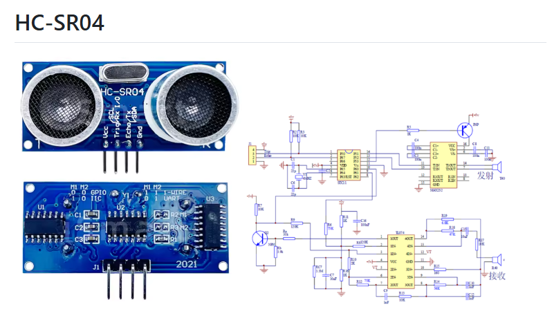
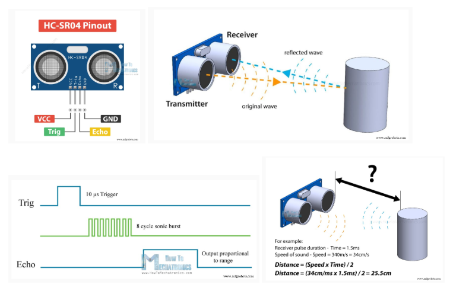
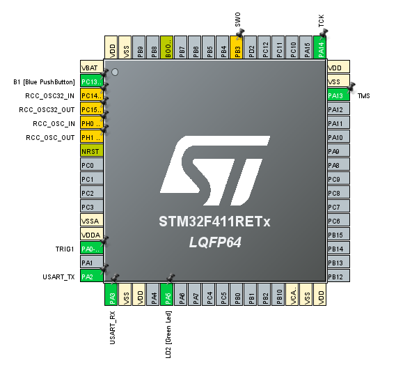
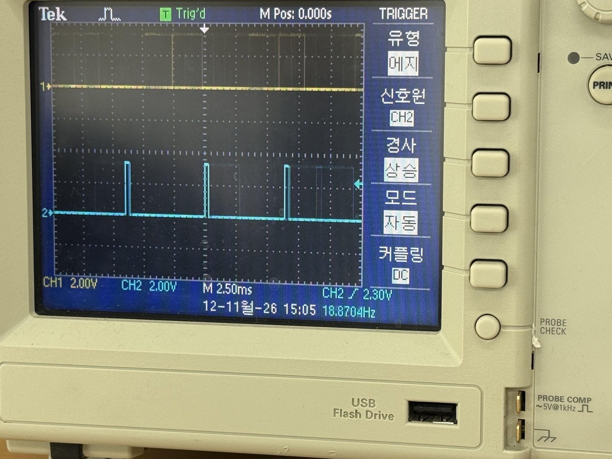
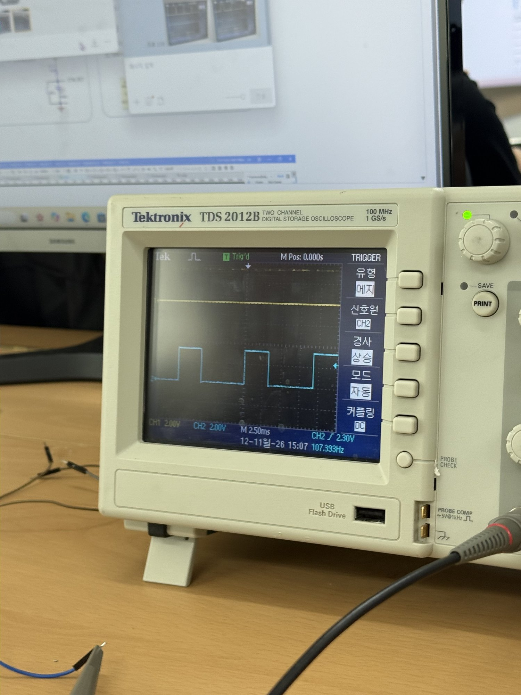
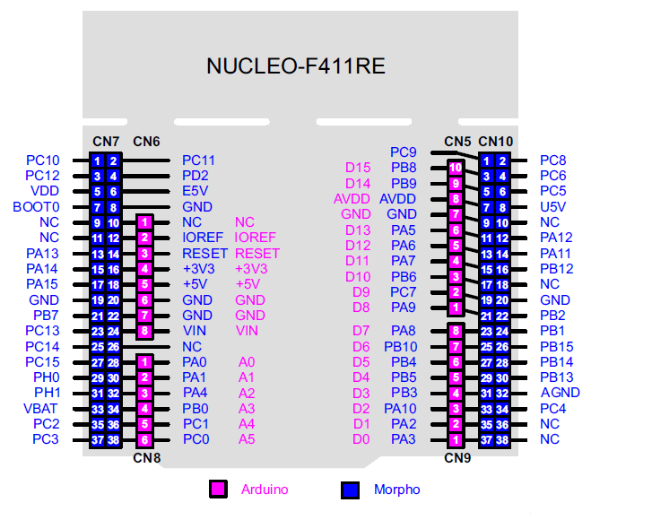
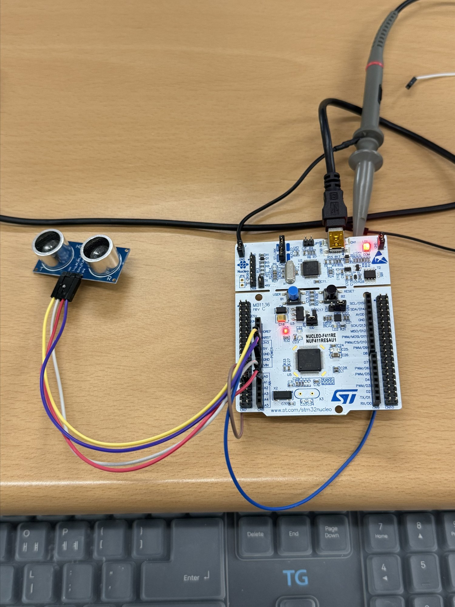

# HC-SR04 (STM32F411)

## HC-SR04 

 <br>
 <br>

## Trig 파형 측정
 while 안에서 trig() 다음에 delay_us만 넣은 코드로 센서의 TRIG 핀 파형을 오실로스코프로 확인.

```c
  

  /* Infinite loop */
  /* USER CODE BEGIN WHILE */
  while (1)
  {
	  trig();
	  delay_us(200);

    /* USER CODE END WHILE */

    /* USER CODE BEGIN 3 */
  }
```

 <br>
 <br>

## TEST

초음파 센서 HC_SR-04를 이용해 앞 물체와의 거리를 바꿔가며 오실로스코프로 파형을 측정.

#### 1. 가까울 때

 <br>

#### 2. 멀 때

 <br>

* 가까울 때는 펄스 폭이 좁고, 멀 때는 펄스 폭이 넓어지는 것을 확인.

## TEST-1

 <br>
 <br>

* PA0 → HC-SR04 TRIG
* PA1 → HC-SR04 ECHO
* 3.3V → HC-SR04 VCC
* GND → HC-SR04 GND
