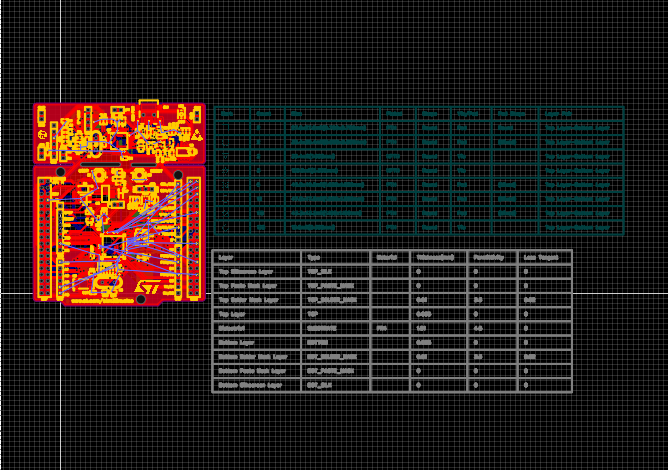

# STM32F411_Project
STM32F411_Project
# H1 제목
## H2 제목  
### H3 제목
#### H4 제목
##### H5 제목
###### H6 제목
*이탤릭체* 또는 _이탤릭체_

**볼드체** 또는 __볼드체__

***볼드 이탤릭*** 또는 ___볼드 이탤릭___

~~취소선~~

`인라인 코드`

- 항목 1
- 항목 2
  - 하위 항목 1
  - 하위 항목 2
    - 더 깊은 하위 항목
    - 
https://www.naver.com/
```javascript
function hello() {
    console.log('Hello World');
}
```
```python
def hello():
    print("Hello World")
```

```
def hello():
    print("Hello World")
```
| 열1 | 열2 | 열3 |
|-----|-----|-----|
| 데이터1 | 데이터2 | 데이터3 |
| 데이터4 | 데이터5 | 데이터6 |




<p align="center">
  
</p>

<p align="center">
  
</p>

<p align="center">
  
</p>

<p align="center">
  
</p>

<p align="center">
  
</p>
